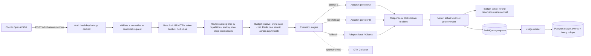

# LLM gateway: product and delivery plan

Owner: Zain Ibrahem · Status: draft v1 · Last updated: 2026-10-14

This document defines what to build and in what order. It contains no code. Decisions marked "decision" are opinionated defaults; anything the owner must still decide is listed in section 6.

---

## 1. Product brief

### Problem
Teams that ship LLM features end up wiring each provider SDK directly into application code. The result is predictable:

- **Outages become product outages.** One provider's 429 storm or 5xx incident takes the feature down, because there is no fallback path.
- **Spend is invisible until the invoice arrives.** Nobody can answer "which team or feature spent what, on which model, yesterday?"
- **Model choice is by habit, not by fit.** Requests that a small model could serve go to the most expensive one because that is what the code was written against.
- **Provider keys are scattered** across services and environment files, with no per-team revocation or limits.

### The product
A self-hostable LLM gateway: one OpenAI-compatible API (`POST /v1/chat/completions`, including streaming) in front of OpenAI, Anthropic, Gemini and local OpenAI-compatible runtimes (Ollama, vLLM). It provides multi-provider fallback, retries, timeouts and circuit breaking; per-tenant API keys, budgets and rate limits; cost-aware routing; per-request token and cost accounting; and a usage dashboard.

### Target users
| Persona | Who they are | What they need from the gateway |
|---|---|---|
| App developer | Engineer building an LLM feature inside a company | Drop-in OpenAI-compatible endpoint, one key, no provider SDK sprawl, stable latency |
| Platform engineer | Owns shared infrastructure; operates the gateway | Fallback policies, circuit breakers, observability, safe secret handling, easy deploy |
| Tenant admin | Team lead or service owner responsible for a tenant | Issue/revoke keys, set budgets and rate limits, see own spend |
| Finance/ops viewer | Finance partner or engineering manager | Read-only spend by tenant, model and time; budget burn-down; no access to keys or prompts |

### Goals
1. A drop-in OpenAI-compatible API that existing OpenAI SDK clients can use by changing only `base_url` and the API key.
2. No single provider failure (outage, 429, 5xx, timeout) causes a client-visible failure when a fallback is configured and healthy.
3. Hard budgets are never overspent by more than one in-flight request's reservation, even under concurrency.
4. Every request has an attributable cost (tenant, key, model, provider, price version) available in the dashboard within 60 seconds.
5. Production-grade engineering signals: tests at three levels, traces/metrics/logs, encrypted secrets, ADRs, one-command local stack, live demo.

### Non-goals (explicitly out of scope)
- Prompt management, prompt versioning or evaluation tooling.
- Semantic caching or response caching (Phase 3 stretch at most).
- Embeddings, image generation, audio, or the Assistants/Responses API surface. MVP is chat completions only.
- Fine-tuning, model hosting, or GPU scheduling.
- Billing end customers or invoicing; costs are internal showback.
- Multi-region active-active deployment.
- Content moderation or guardrails beyond basic request size limits.

### Portfolio success metrics (what a hiring manager sees in 5 minutes)
1. **README first screen**: one-paragraph pitch, architecture diagram, "run it in one command" (`docker compose up`), live demo link.
2. **A 90-second demo GIF/video**: a request streams through; the primary provider is killed via the fault-injection mock; traffic fails over with zero client errors; the dashboard shows the fallback spike and spend.
3. **Green CI badge** with unit, contract and integration suites, plus a published load test result (e.g. p95 gateway overhead under 15 ms at 200 RPS against the mock provider).
4. **A Grafana (or dashboard) screenshot** showing traces that span auth, budget, routing, provider call and metering.
5. **`docs/adr/`** with 5–8 short architecture decision records (stack, budget atomicity, pricing versioning, fallback semantics during streaming, key storage).
6. **Security story in one page**: hashed gateway keys, envelope-encrypted provider credentials, prompt-content redaction in logs.

---

## 2. Recommended tech stack (decision)

| Concern | Choice | Why |
|---|---|---|
| Gateway language/runtime | TypeScript on Node.js 22 LTS | First-class streaming/SSE and async I/O, strong typing for the canonical schema, one language across gateway and dashboard. |
| HTTP framework | Fastify | Low overhead, schema-first routes, mature plugin and hook model for the auth/budget/metering pipeline. |
| Validation and schema | Zod (with zod-to-json-schema for OpenAPI) | Single source of truth for request/response types, runtime validation and generated docs. |
| Primary store | PostgreSQL 16 | Tenants, keys, catalog, pricing versions and usage events need relational integrity and SQL aggregation. |
| ORM/migrations | Drizzle ORM + drizzle-kit | Typed SQL without hiding queries; plain SQL migrations reviewable in PRs. |
| Hot counters | Redis 7 (Lua scripts) | Atomic budget reservation and rate limiting in one round trip; Postgres remains source of truth. |
| Async metering | BullMQ on Redis | Decouples usage persistence from the request path with retries and a dead-letter queue, without adding Kafka. |
| Observability | OpenTelemetry SDK (traces + metrics) → OTel Collector → Grafana stack (Tempo, Prometheus, Loki) locally; Grafana Cloud free tier in the demo | Vendor-neutral instrumentation, which is what platform teams expect. |
| Logging | Pino (JSON) with redaction paths | Fast structured logs, trace-id correlation, built-in field redaction. |
| Dashboard | Next.js (App Router) + Tailwind + Recharts, Auth.js for login | Server components query the admin API; fast to build credible charts. |
| Testing | Vitest (unit), Testcontainers (Postgres/Redis integration), a purpose-built mock provider service (contract and fault injection), k6 (load) | Covers every layer without hitting paid APIs in CI. |
| Packaging | pnpm workspaces monorepo; Docker multi-stage images | One repo for `gateway`, `dashboard`, `mock-provider`, shared `schema` package. |
| Local environment | Docker Compose (gateway, dashboard, Postgres, Redis, OTel Collector, Grafana, Ollama optional, mock provider) | One-command stack for reviewers. |
| CI | GitHub Actions | Lint, typecheck, tests, image build, deploy on main. |
| Deploy target | Fly.io (gateway + dashboard + mock provider), Neon Postgres, Upstash Redis | Cheap managed services, quick public URL, no Kubernetes yak-shaving for a solo project. |
| Secrets | Fly secrets for the master key; provider credentials envelope-encrypted (AES-256-GCM) in Postgres | Demonstrates key management without needing a cloud KMS; KMS adapter is a documented extension point. |

---

## 3. High-level architecture

### Components
- **Gateway API** (Fastify): public data plane (`/v1/*`) and admin control plane (`/admin/v1/*`) in one deployable for MVP, separated by route prefix, auth scheme and middleware.
- **Provider adapters**: one module per provider family implementing a common `ProviderAdapter` interface (translate request, call, translate response, translate stream chunks, map errors to a canonical error taxonomy, extract usage).
- **Router**: resolves the requested `model` (concrete like `openai/gpt-4o-mini`, or virtual like `auto` / `gw/cheap-fast`) into an ordered candidate list using the model catalog, capability requirements, price and health.
- **Execution engine**: walks the candidate list with per-attempt timeouts, retries with jittered exponential backoff, circuit breaker checks and fallback.
- **Budget and rate-limit service**: Redis Lua scripts for atomic reserve/settle and token-bucket rate limits; reconciled from Postgres.
- **Metering pipeline**: computes cost from actual usage and the effective price version; enqueues a usage event; a worker writes to Postgres and updates rollups.
- **Postgres**: tenants, api_keys, provider_credentials, models, model_prices, routing_policies, budgets, usage_events, usage_rollups_hourly, audit_log.
- **Dashboard** (Next.js): reads only through the admin API.
- **Mock provider**: OpenAI/Anthropic/Gemini-shaped fake upstream with controllable latency, errors and token counts, used by tests, load tests and the public demo.

### Request lifecycle



Step by step:
1. **Auth**: `Authorization: Bearer gw_live_<prefix>_<secret>`. Look up by prefix, verify SHA-256 hash of the secret (constant-time compare). Result cached in-process for 30 s; revocation publishes a Redis pub/sub invalidation.
2. **Validate**: Zod-validate the OpenAI-shaped body; normalise into the canonical request (messages, tools, response_format, max_tokens, stream, gateway extension block).
3. **Rate limit**: per-key and per-tenant RPM and TPM buckets (TPM uses estimated prompt tokens + `max_tokens`). Exceeded → `429` with `Retry-After`.
4. **Route**: build the candidate list (see "Cost-aware routing" below). Empty list → `400 no_eligible_model`.
5. **Budget reserve**: reserve the worst-case cost of the first candidate. Exceeded hard limit → `402 budget_exceeded`.
6. **Execute**: for each candidate: skip if circuit open; call with per-attempt timeout; on retryable error retry the same provider up to N times with backoff, then fall back to the next candidate. If fallback moves to a pricier model than reserved, re-reserve the difference first.
7. **Stream**: SSE chunks are translated to OpenAI chunk shape and flushed as they arrive. **Fallback is only allowed before the first byte is sent to the client.** After first byte, a mid-stream provider failure emits a terminal SSE error event and is metered for tokens already produced.
8. **Meter**: prefer provider-reported usage; for streams request `stream_options.include_usage` where supported; otherwise count with a local tokenizer and mark `usage_source = estimated`.
9. **Settle**: release `reserved - actual` from Redis counters.
10. **Persist**: enqueue a usage event (idempotent on `request_id`); the worker inserts into `usage_events` and upserts `usage_rollups_hourly`.
11. **Respond**: add headers `x-request-id`, `x-gateway-provider`, `x-gateway-model`, `x-gateway-attempts`, `x-gateway-cost-usd`.

### Model catalog and pricing table design
- `models`: `id` (`provider/model`, e.g. `anthropic/claude-x`), `provider`, `upstream_model_name`, `context_window`, `max_output_tokens`, capability booleans (`supports_tools`, `supports_vision`, `supports_json_mode`, `supports_streaming`), `quality_tier` (1–3), `latency_tier` (`fast` | `standard` | `slow`), `enabled`.
- `model_prices`: `id`, `model_id`, `input_price_per_mtok_micros`, `output_price_per_mtok_micros`, `cached_input_price_per_mtok_micros` (nullable), `currency` (`USD`), `effective_from`, `effective_to` (nullable), `source_url`, `recorded_at`. **Prices are append-only and versioned**; a price change inserts a new row and closes the previous one.
- `usage_events.price_id` references the exact price row used, so historical cost never changes when prices change.
- Money is stored as **integer micro-USD** (1 USD = 1,000,000) everywhere; no floats.
- Catalog is seeded from a reviewed `catalog/models.yaml` checked into the repo (prices copied from provider pricing pages with `source_url` and date) and loaded by a migration/seed command. Local models have price 0 but still record tokens.
- Virtual models (`auto`, `gw/cheap-fast`, `gw/best-quality`) are rows in `routing_policies` mapping to requirement sets and an optional explicit fallback chain.

### Cost-aware routing (summary)
Requirements come from the request (tools present → `supports_tools`; image parts → `supports_vision`; `response_format: json_object` → `supports_json_mode`; estimated prompt + `max_tokens` → minimum context window) plus optional `gateway` extension fields (`min_quality_tier`, `latency_tier`, `max_cost_usd`). The router filters enabled models meeting all requirements, removes providers whose circuit is open or whose credentials are missing for the tenant, sorts by estimated cost (input estimate × input price + `max_tokens` × output price), and tie-breaks by observed p95 latency. The top N (default 3) form the fallback chain. The decision is returned in the `x-gateway-route-reason` header and recorded on the usage event.

### Atomic budget enforcement under concurrency
- Budgets are per tenant (and optionally per key) with `period` (`daily` | `monthly`, UTC), `hard_limit_micros`, `soft_limit_micros`.
- Redis keys: `budget:{tenant}:d:{YYYYMMDD}` and `budget:{tenant}:m:{YYYYMM}` hold `spent + reserved` in micros; TTL slightly longer than the period.
- **Reserve** is one Lua script that checks every applicable key against its hard limit and increments all of them only if all pass. Because Redis executes Lua atomically, concurrent requests cannot jointly overshoot: the worst case is bounded by the reservation estimate, not by concurrency.
- **Settle** is a second Lua script that applies `actual - reserved` (normally negative) to the same keys. Reservations carry a request id with a TTL "lease" key; a sweeper refunds leases orphaned by crashes after 10 minutes.
- **Reconciliation**: on startup and every 5 minutes, a job recomputes period totals from `usage_events` in Postgres and corrects Redis drift (Postgres is the source of truth). If Redis is unavailable, the gateway fails **closed** for tenants with hard limits and **open** (with alert) for tenants without hard limits; configurable.
- Soft limit crossing emits a one-time event per period (log, metric, optional webhook in Phase 3).

---

## 4. Phased roadmap

Assumes part-time solo work of roughly 10–12 hours per week.

| Phase | Weeks | Scope | Exit criteria |
|---|---|---|---|
| **Phase 0: setup** | 1–2 | GW-1.1, GW-1.2, GW-1.3 | `docker compose up` brings up gateway skeleton, Postgres, Redis, Grafana stack; CI runs lint, typecheck and tests on every PR; migrations apply from zero; `GET /healthz` and `GET /readyz` respond. |
| **Phase 1: MVP** | 3–10 | GW-2.1–2.3, 2.5, 2.6; GW-3.1, 3.2, 3.4; GW-4.1–4.3; GW-5.1, 5.2; GW-6.1, 6.3; GW-7.1, 7.2; GW-8.1, 8.3; GW-9.1, 9.2; GW-10.1, 10.3, 10.4 | An OpenAI SDK client streams completions through the gateway against OpenAI, Anthropic and Ollama; killing the primary in the mock provider yields zero client errors; hard budget blocks requests with `402` under a 50-way concurrent test with overshoot under one reservation; every request has a usage row with cost; dashboard shows spend by tenant and model; deployed publicly with a README. |
| **Phase 2: hardening and depth** | 11–15 | GW-2.4; GW-3.3; GW-5.3; GW-6.2; GW-7.3, 7.4; GW-8.2; GW-9.3, 9.4; GW-10.2 | Gemini adapter live; circuit breaker visible in metrics; capability inference routes vision/tool requests automatically; hourly rollups power the dashboard; reliability screen shows error/fallback rates and p50/p95; k6 report committed with gateway overhead numbers. |
| **Phase 3: polish and stretch** | 16–19 | GW-10.5; soft-limit webhooks (GW-5.3 flag on); ADRs complete; demo video | Public demo with seeded traffic generator; 90-second video; all ADRs written. Stretch (unticketed, only if time allows): response caching, per-feature tags for showback, KMS adapter, Helm chart. |

---

## 5. Epics and backlog

**Ticket labels.** There are no design step labels for this project, so each ticket uses a label of the form `GW-<epic#>.<n>` (e.g. `GW-2.3`).

**Feature flags.** No codebase exists yet, so every flag name below is a **proposed** name. Flags are read from environment config with optional per-tenant override in the `tenant_settings` table (introduced in GW-4.1).

**Error responses** referenced in acceptance criteria use the OpenAI error envelope `{ "error": { "type", "code", "message" } }`.

### Epic 1: Foundations (repo, CI, local infra)

```
[GW-1.1: Monorepo and CI pipeline]

User Story
As a gateway maintainer, I want to push a branch and get automated lint, typecheck, test and image build results, so that I can merge changes with confidence and show a green build to reviewers.

Business Rationale
A visible, trustworthy CI pipeline is the first signal of engineering maturity a reviewer checks. It also prevents regressions as the gateway grows across adapters, routing and metering.

Type: NEW FEATURE | Size: S

Dependencies: None
Feature Flags: None
Technical Notes: pnpm workspaces with packages `gateway`, `dashboard`, `mock-provider`, `schema`. GitHub Actions jobs: lint (ESLint + Prettier check), typecheck (`tsc --noEmit` across all packages), unit tests (Vitest), Docker build. Cache pnpm store. Branch protection on `main` requires all jobs. Conventional commits enforced by commitlint.

Acceptance Criteria

1. Given a pull request against main - When CI runs - Then lint, typecheck, unit test and docker build jobs each report a status on the PR
2. Given a commit that introduces a type error in any package - When CI runs - Then the typecheck job fails and the PR cannot be merged
3. Given a commit message that does not follow conventional commits - When the commitlint job runs - Then the job fails with the offending message in its output
4. Given an unchanged lockfile on a second run - When CI installs dependencies - Then the pnpm cache is restored and logged as a cache hit
```

```
[GW-1.2: Local stack and configuration loading]

User Story
As a platform engineer evaluating the gateway, I want to start the full stack with one command and a single env file, so that I can try it locally without manual setup.

Business Rationale
A one-command local environment is the most effective way to let reviewers and future contributors try the product. Validated configuration also prevents the most common class of deploy failures.

Type: NEW FEATURE | Size: S

Dependencies: GW-1.1
Feature Flags: None
Technical Notes: Docker Compose services: gateway, dashboard, postgres, redis, otel-collector, grafana (with Tempo, Prometheus, Loki), mock-provider; ollama behind a compose profile `local-models`. Config loaded from env via a Zod schema at boot; the process exits non-zero listing every invalid or missing variable. `.env.example` documents every variable. `GET /healthz` (process up) and `GET /readyz` (Postgres and Redis reachable) endpoints.

Acceptance Criteria

1. Given a fresh clone with .env.example copied to .env - When the engineer runs docker compose up - Then all services report healthy within 120 seconds and GET /readyz returns 200
2. Given a missing required variable such as DATABASE_URL - When the gateway starts - Then the process exits with a non-zero code and logs the name of every missing variable
3. Given Redis is stopped - When GET /readyz is called - Then it returns 503 with a body naming redis as the failing dependency while GET /healthz still returns 200
4. Given the local-models profile is enabled - When docker compose --profile local-models up runs - Then an ollama container starts and is reachable from the gateway container
```

```
[GW-1.3: Database schema and migrations]

User Story
As a gateway maintainer, I want versioned, reviewable database migrations for the core schema, so that every environment has the same schema and changes are auditable.

Business Rationale
Tenants, keys, catalog, prices and usage are the backbone of cost governance. A disciplined migration workflow avoids data loss and drift between local, CI and production.

Type: NEW FEATURE | Size: M

Dependencies: GW-1.2
Feature Flags: None
Technical Notes: Drizzle schema and SQL migrations for tenants, tenant_settings, api_keys, provider_credentials, models, model_prices, routing_policies, budgets, usage_events, usage_rollups_hourly, audit_log. Money columns are bigint micro-USD. usage_events partitioned by month (declarative partitioning) with an index on (tenant_id, created_at). Migrations run as a separate one-off command, never on gateway boot in production. Integration tests use Testcontainers Postgres.

Acceptance Criteria

1. Given an empty database - When the migrate command runs - Then all tables exist and the migration journal lists every migration as applied
2. Given a fully migrated database - When the migrate command runs again - Then it exits 0 and applies no changes
3. Given a usage_events insert with a created_at in a month without a partition - When the insert runs - Then the row is stored in an automatically created partition for that month
4. Given an attempt to insert a fractional amount into a money column - Then the database rejects the insert
```

### Epic 2: Unified API and provider adapters

```
[GW-2.1: Canonical chat completions endpoint]

User Story
As an app developer, I want to send OpenAI-format chat completion requests to the gateway with my gateway key, so that I can switch providers without changing my application code.

Business Rationale
OpenAI compatibility is the adoption lever: existing SDKs and tools work by changing base_url. Every downstream capability (routing, budgets, metering) builds on this canonical request shape.

Type: NEW FEATURE | Size: M

Dependencies: GW-1.2, GW-4.2
Feature Flags: None
Technical Notes: POST /v1/chat/completions, non-streaming in this ticket. Canonical request and response types live in the shared schema package. Supported fields: model, messages (text and image_url parts), tools, tool_choice, response_format, temperature, top_p, max_tokens, stop, stream, user, plus an optional gateway extension object. Unknown top-level fields are ignored and logged at debug level. Request body size capped at 1 MB (configurable). Defines the canonical error taxonomy (invalid_request, authentication, rate_limited, budget_exceeded, provider_error, provider_timeout, no_eligible_model) and its HTTP mapping. Every response carries x-request-id.

Acceptance Criteria

1. Given a valid gateway key and a request for model openai/gpt-4o-mini - When the developer calls POST /v1/chat/completions with the official OpenAI SDK - Then the SDK parses the response without error and the response includes id, choices, usage and an x-request-id header
2. Given a request missing the messages field - When it is sent - Then the gateway returns 400 with error.type invalid_request and error.message naming the messages field
3. Given a request body larger than the configured limit - When it is sent - Then the gateway returns 413 and no provider is called
4. Given a request containing an unknown top-level field - When it is sent - Then the gateway returns 200 and the field is not forwarded to the provider
```

```
[GW-2.2: OpenAI provider adapter]

User Story
As a platform engineer, I want the gateway to call OpenAI through a provider adapter, so that tenants can use OpenAI models behind the unified API.

Business Rationale
OpenAI is the reference provider and the shape the API mirrors, making it the baseline adapter. Its adapter defines the interface every other provider follows.

Type: NEW FEATURE | Size: S

Dependencies: GW-2.1, GW-4.3
Feature Flags: None
Technical Notes: Implements the ProviderAdapter interface: buildRequest, send, parseResponse, parseStreamChunk, mapError, extractUsage. Uses undici with keep-alive connection pooling. Error mapping: 429 → rate_limited (retryable), 5xx → provider_error (retryable), 400 → invalid_request (not retryable), 401/403 → provider_auth (not retryable for that provider, eligible for fallback). Reads base URL from the provider_credentials row so the same adapter can target Azure-style or proxy endpoints later.

Acceptance Criteria

1. Given a tenant with a valid OpenAI credential - When a request for an openai model is sent - Then the response content and usage token counts match the upstream response
2. Given the upstream returns 429 - When the adapter maps the error - Then the canonical error is rate_limited and marked retryable
3. Given the upstream returns 400 for an invalid parameter - Then the gateway returns 400 invalid_request to the client and does not retry or fall back
4. Given the upstream returns 401 - Then the attempt is recorded as provider_auth and the execution engine is allowed to try the next candidate
```

```
[GW-2.3: Anthropic provider adapter]

User Story
As an app developer, I want to call Anthropic models through the same OpenAI-format request, so that I can use Claude models without adopting a second SDK.

Business Rationale
Anthropic is the most common second provider and the most common fallback target. Translating between the two message formats is the core technical proof of a unified API.

Type: NEW FEATURE | Size: M

Dependencies: GW-2.2
Feature Flags: None
Technical Notes: Translation rules: system messages are concatenated into the top-level system field; consecutive same-role messages are merged; tools map to Anthropic tool definitions and tool_use/tool_result blocks map to OpenAI tool_calls and tool role messages; image_url parts map to image blocks (base64 or URL); max_tokens is required by Anthropic so the adapter applies the catalog max_output_tokens default when absent; stop_reason maps to finish_reason (end_turn → stop, max_tokens → length, tool_use → tool_calls). response_format json_object is emulated with a system instruction and recorded as emulated.

Acceptance Criteria

1. Given a request with a system message and two user turns - When it is routed to an anthropic model - Then the upstream request has a top-level system field and the response is returned in OpenAI chat completion shape
2. Given a request with tools - When the model responds with a tool call - Then the client receives choices[0].message.tool_calls with the function name and JSON arguments and finish_reason tool_calls
3. Given a request without max_tokens - When it is routed to an anthropic model - Then the upstream request includes max_tokens equal to the catalog default for that model
4. Given a conversation that starts with an assistant message - When it is routed to an anthropic model - Then the gateway returns 400 invalid_request with a message explaining the ordering constraint
```

```
[GW-2.4: Gemini provider adapter]

User Story
As an app developer, I want to call Gemini models through the same OpenAI-format request, so that I can use Google models for cost or context-length advantages.

Business Rationale
A third commercial provider widens the routing space and makes cost-aware routing meaningfully different from a two-way switch. Gemini's long context windows make it a natural target for large-prompt requests.

Type: NEW FEATURE | Size: M

Dependencies: GW-2.3
Feature Flags: ff_provider_gemini
Technical Notes: Uses the native Gemini generateContent and streamGenerateContent APIs (not the OpenAI-compatible shim) so translation is explicit and tested. Role mapping: assistant → model; system → systemInstruction. Tools map to functionDeclarations. Safety-blocked responses map to finish_reason content_filter. When ff_provider_gemini is off, gemini models are excluded from the router and direct requests return 400 no_eligible_model.

Acceptance Criteria

1. Given ff_provider_gemini is on and a tenant with a Gemini credential - When a request for a gemini model is sent - Then the client receives an OpenAI-shaped response with usage populated from usageMetadata
2. Given a Gemini response blocked by safety settings - Then the client receives finish_reason content_filter and an empty content field
3. Given ff_provider_gemini is off - When a request names a gemini model - Then the gateway returns 400 no_eligible_model and no call is made to Gemini
4. Given ff_provider_gemini is off - When the router builds an auto candidate list - Then no gemini model appears in x-gateway-route-reason
```

```
[GW-2.5: Local OpenAI-compatible adapter]

User Story
As a platform engineer, I want to register Ollama or vLLM endpoints as a provider, so that tenants can route low-sensitivity or offline workloads to free local models.

Business Rationale
Local models are the zero-cost floor of cost-aware routing and the last-resort fallback during commercial outages. They also make the public demo affordable to run.

Type: NEW FEATURE | Size: S

Dependencies: GW-2.2
Feature Flags: None
Technical Notes: Reuses the OpenAI adapter with provider type local and a configurable base URL per credential. No API key required. Capabilities and context windows come from the catalog, not auto-discovery. Price rows are zero but tokens are still recorded. If the endpoint does not return usage, tokens are estimated and usage_source is set to estimated.

Acceptance Criteria

1. Given a local provider registered with an Ollama base URL - When a request for local/llama3 is sent - Then the response is returned in OpenAI shape with cost 0 and token counts populated
2. Given the local endpoint omits usage in its response - Then the usage event is stored with usage_source estimated and non-zero token counts
3. Given the local endpoint is unreachable - Then the attempt is recorded as provider_error and the execution engine moves to the next candidate if one exists
```

```
[GW-2.6: Server-sent event streaming]

User Story
As an app developer, I want to receive streamed tokens in OpenAI SSE format from any provider, so that my chat UI shows output as it is generated.

Business Rationale
Streaming is table stakes for interactive LLM products; a gateway without it cannot be adopted. It also forces the hardest design decisions around fallback and cost accounting, which are key interview talking points.

Type: NEW FEATURE | Size: L

Dependencies: GW-2.2, GW-2.3, GW-2.5
Feature Flags: None
Technical Notes: stream: true returns text/event-stream with OpenAI chat.completion.chunk events and a final data: [DONE]. Each adapter translates provider stream events into canonical chunks. Fallback is permitted only before the first byte is flushed to the client; after that, a provider failure emits a final chunk with an error object followed by [DONE]. If the client sets stream_options.include_usage, the final chunk carries usage. Client disconnect aborts the upstream request via AbortController and meters tokens produced so far. Heartbeat comment lines every 15 seconds keep proxies from closing idle connections.

Acceptance Criteria

1. Given stream true and an anthropic model - When the request is sent with the OpenAI SDK streaming helper - Then the client receives incremental content deltas and a terminating [DONE] event
2. Given stream true and stream_options.include_usage true - Then the last data chunk before [DONE] contains prompt_tokens, completion_tokens and total_tokens
3. Given the primary provider fails before the first chunk is sent - Then the gateway falls back to the next candidate and the client receives a single uninterrupted stream
4. Given the provider fails after 20 chunks have been sent - Then the client receives an error chunk then [DONE], no fallback is attempted, and a usage event is stored with status partial
5. Given the client disconnects mid-stream - Then the upstream request is aborted within 1 second and a usage event is stored with status client_cancelled
```

### Epic 3: Reliability (timeouts, retries, circuit breaking, fallback)

```
[GW-3.1: Per-request and per-provider timeouts]

User Story
As an app developer, I want to set a request deadline and have the gateway enforce provider timeouts, so that my service never hangs on a slow upstream.

Business Rationale
Unbounded upstream latency cascades into thread and connection exhaustion in calling services. Deadlines are also what make fallback fast enough to be useful.

Type: NEW FEATURE | Size: S

Dependencies: GW-2.2
Feature Flags: None
Technical Notes: Three timeouts: connect timeout (per provider, default 3 s), time-to-first-token timeout (per provider, default 20 s), and overall request deadline (client header x-gateway-timeout-ms, default 60 s, capped at 300 s). Each attempt's budget is min(provider timeout, remaining deadline). Streaming uses the time-to-first-token timeout plus an inter-chunk idle timeout (default 30 s).

Acceptance Criteria

1. Given a provider that delays its first byte beyond the time-to-first-token timeout - When a request is sent - Then the attempt is aborted, recorded as provider_timeout, and the next candidate is tried
2. Given x-gateway-timeout-ms set to 5000 and all providers slower than that - Then the client receives 504 with error.type provider_timeout within 5.5 seconds
3. Given x-gateway-timeout-ms set above 300000 - Then the gateway applies 300000 and the effective deadline is reported in the x-gateway-deadline-ms response header
4. Given a stream that goes idle longer than the inter-chunk timeout after first byte - Then the client receives an error chunk then [DONE]
```

```
[GW-3.2: Retries with jittered backoff]

User Story
As an app developer, I want transient provider errors to be retried automatically, so that brief upstream blips do not surface as failures in my product.

Business Rationale
Most provider errors are transient 429 and 5xx responses. Automatic, bounded retries recover them invisibly while protecting providers from retry storms.

Type: NEW FEATURE | Size: S

Dependencies: GW-3.1
Feature Flags: None
Technical Notes: Retry only canonical errors marked retryable (rate_limited, provider_error, provider_timeout, connection errors). Exponential backoff with full jitter: base 200 ms, cap 2 s, max 2 retries per provider (configurable per provider). Honour upstream Retry-After when it is shorter than the remaining deadline; if longer, skip to fallback instead of waiting. No retry once streaming has sent the first byte. Each attempt is a child span with attempt number.

Acceptance Criteria

1. Given a provider that returns 503 once then 200 - When a request is sent - Then the client receives 200 and x-gateway-attempts equals 2
2. Given a provider that returns 429 with Retry-After of 30 seconds and a 10 second deadline - Then the gateway does not wait and moves to the next candidate immediately
3. Given a provider that returns 400 - Then no retry occurs and x-gateway-attempts equals 1
4. Given a provider that returns 500 on every attempt and no fallback candidate - Then the client receives 502 provider_error after exactly 3 attempts
```

```
[GW-3.3: Per-provider circuit breaker]

User Story
As a platform engineer, I want the gateway to stop sending traffic to a provider that is failing, so that requests skip known-bad upstreams instead of waiting for timeouts.

Business Rationale
During provider incidents, repeatedly attempting a dead upstream adds seconds of latency to every request and amplifies load on the provider. Circuit breaking turns outages into near-instant fallbacks.

Type: NEW FEATURE | Size: M

Dependencies: GW-3.2, GW-3.4
Feature Flags: ff_circuit_breaker
Technical Notes: State per provider+model kept in Redis so all gateway instances share it. Closed → open when the failure rate over a 30 s rolling window exceeds 50% with at least 20 requests. Open for 30 s, then half-open allows 5 probe requests; all succeed → closed, any fail → open again. Only retryable errors count as failures (invalid_request does not). State changes emit a log event and the gateway_circuit_state metric. When ff_circuit_breaker is off, all candidates are always attempted.

Acceptance Criteria

1. Given ff_circuit_breaker is on and a provider failing 60% of 25 requests within 30 seconds - Then the circuit opens and subsequent requests skip that provider with no upstream call
2. Given an open circuit after 30 seconds - When 5 probe requests succeed - Then the circuit closes and gateway_circuit_state reports closed
3. Given a half-open circuit - When one probe fails - Then the circuit returns to open for another 30 seconds
4. Given 100 invalid_request errors from a provider - Then the circuit stays closed
5. Given ff_circuit_breaker is off - When a provider fails every request - Then every request still attempts that provider first
```

```
[GW-3.4: Fallback chains]

User Story
As a platform engineer, I want to define ordered fallback chains across providers, so that a request survives a single provider's outage without client changes.

Business Rationale
Fallback is the headline reliability feature and the clearest demo of the product's value. It converts provider SLAs into a composite availability higher than any single provider.

Type: NEW FEATURE | Size: M

Dependencies: GW-3.2, GW-6.1
Feature Flags: None
Technical Notes: Fallback chains are defined on routing_policies (virtual models) as an ordered list of concrete models, or produced by the cost-aware router. A request naming a concrete model uses that model only, unless the request sets gateway.fallback: true, in which case the tenant default chain is appended. Fallback triggers: retryable errors after retries are exhausted, provider_auth, open circuit, timeouts. Never on invalid_request or budget_exceeded. Each candidate must satisfy the request's capability requirements; incompatible candidates are skipped and logged. Max chain length 4.

Acceptance Criteria

1. Given a virtual model with chain openai → anthropic → local and OpenAI returning 503 on all attempts - When a request is sent - Then the response comes from anthropic and x-gateway-provider equals anthropic
2. Given a concrete model request without gateway.fallback - When that provider fails - Then the client receives the error and no other provider is called
3. Given a request with tools and a chain whose second entry lacks tool support - Then that entry is skipped and the third entry is attempted
4. Given every candidate in the chain fails - Then the client receives 502 with an error.message listing each provider and its canonical error
5. Given the first provider returns invalid_request - Then no fallback occurs
```

### Epic 4: Tenancy and security

```
[GW-4.1: Tenant and API key management]

User Story
As a tenant admin, I want to create, list and revoke gateway API keys for my tenant, so that each service has its own revocable credential.

Business Rationale
Per-tenant, per-service keys are the unit of attribution for cost and the unit of containment for incidents. Without them there is no multi-tenancy or showback.

Type: NEW FEATURE | Size: M

Dependencies: GW-1.3
Feature Flags: None
Technical Notes: Key format gw_live_<8-char prefix>_<32-byte base62 secret>. Only the SHA-256 hash and the prefix are stored; the full key is shown once at creation. Keys have name, tenant_id, created_by, expires_at (optional), last_used_at (updated at most once a minute), revoked_at. Endpoints in GW-9.1 call this service. Revocation publishes a Redis invalidation so cached auth entries drop within 1 second. All key operations write to audit_log.

Acceptance Criteria

1. Given a tenant admin - When they create a key named billing-service - Then the response contains the full key once and later list calls show only the prefix and name
2. Given a revoked key - When it is used on POST /v1/chat/completions within 2 seconds of revocation - Then the gateway returns 401
3. Given a key past its expires_at - When it is used - Then the gateway returns 401 with error.code key_expired
4. Given any key creation or revocation - Then an audit_log row records the actor, action, key prefix and timestamp
5. Given a database dump - Then no column contains a plaintext gateway key secret
```

```
[GW-4.2: Gateway key authentication middleware]

User Story
As a platform engineer, I want every data-plane request authenticated against a hashed key with low overhead, so that only known tenants can spend money through the gateway.

Business Rationale
Authentication is on the hot path of every request, so it must be both secure and fast. It also attaches the tenant context that budgets, routing and metering depend on.

Type: NEW FEATURE | Size: S

Dependencies: GW-4.1
Feature Flags: None
Technical Notes: Parses Authorization Bearer, looks up by prefix, compares hashes with crypto.timingSafeEqual. In-process LRU cache (30 s TTL, invalidated via Redis pub/sub). Attaches tenant_id, key_id and tenant settings to the request context and the active span. Failed attempts are rate limited per source IP (20 per minute) to slow brute force. Admin routes use a separate scheme (GW-9.1) and reject data-plane keys.

Acceptance Criteria

1. Given a valid key - When a request is sent - Then the request proceeds and the trace span carries tenant.id and key.prefix attributes
2. Given a missing Authorization header - Then the gateway returns 401 with error.type authentication
3. Given 21 failed authentication attempts from one IP within a minute - Then the 21st returns 429 regardless of key validity
4. Given a valid data-plane key used against an /admin/v1 route - Then the gateway returns 403
5. Given a warm cache - Then the authentication step adds under 1 ms at p95 as measured by its span duration in the load test
```

```
[GW-4.3: Encrypted provider credentials]

User Story
As a tenant admin, I want to store my organisation's provider API keys in the gateway encrypted at rest, so that application teams never see or handle raw provider keys.

Business Rationale
Centralising provider keys removes secret sprawl across services and enables instant rotation. Demonstrable envelope encryption is a strong security signal for platform roles.

Type: NEW FEATURE | Size: M

Dependencies: GW-1.3
Feature Flags: None
Technical Notes: Envelope encryption: a per-credential data key encrypts the provider secret with AES-256-GCM; the data key is encrypted with a master key from GATEWAY_MASTER_KEY (Fly secret). A key_version column supports master key rotation via a re-encrypt command. Decrypted secrets are cached in memory for 5 minutes and never logged or returned by any API (responses show last 4 characters only). Credentials can be tenant-scoped or platform-default; tenant-scoped wins. A KeyProvider interface allows a future cloud KMS implementation.

Acceptance Criteria

1. Given a tenant admin stores an Anthropic key - When the provider_credentials row is inspected - Then the secret column contains ciphertext and no substring of the original key
2. Given a stored credential - When it is read through the admin API - Then only the provider, label and last 4 characters are returned
3. Given the master key is rotated and the re-encrypt command runs - Then all credentials decrypt under the new key_version and requests continue to succeed
4. Given GATEWAY_MASTER_KEY is missing or the wrong length at startup - Then the gateway exits non-zero before accepting traffic
5. Given a tenant with no tenant-scoped credential for a provider - Then the platform-default credential is used and the usage event records credential_scope platform
```

### Epic 5: Budgets and rate limiting

```
[GW-5.1: Request and token rate limits]

User Story
As a tenant admin, I want to set requests-per-minute and tokens-per-minute limits per key and per tenant, so that one runaway service cannot starve others or exhaust provider quotas.

Business Rationale
Rate limits protect shared provider quotas and contain bugs such as retry loops in client code. They are a core multi-tenancy fairness control.

Type: NEW FEATURE | Size: M

Dependencies: GW-4.2
Feature Flags: None
Technical Notes: Token bucket implemented as one Redis Lua script checking key-level and tenant-level buckets atomically. TPM cost is estimated as prompt token estimate plus max_tokens at admission, then corrected with actual tokens after completion (debit or credit). Limits null means unlimited. Response headers follow the OpenAI convention: x-ratelimit-limit-requests, x-ratelimit-remaining-requests, x-ratelimit-limit-tokens, x-ratelimit-remaining-tokens. If Redis is unavailable, rate limiting fails open and increments gateway_ratelimit_degraded_total.

Acceptance Criteria

1. Given a key limited to 10 RPM - When 11 requests arrive within one minute - Then the 11th returns 429 with error.code rate_limit_requests and a Retry-After header
2. Given a tenant TPM limit of 10000 and a request with max_tokens 12000 - Then the request returns 429 with error.code rate_limit_tokens before any provider call
3. Given a key limit of 100 RPM and a tenant limit of 50 RPM - Then requests are rejected after 50 within the minute
4. Given Redis is unavailable - Then requests are admitted and gateway_ratelimit_degraded_total increases
5. Given an allowed request - Then the response includes the four x-ratelimit headers with remaining values that decrease across successive requests
```

```
[GW-5.2: Atomic budget reservation and settlement]

User Story
As a finance viewer, I want each tenant's daily and monthly hard budgets enforced even under heavy concurrency, so that spend can never run away beyond the agreed limit.

Business Rationale
Hard spend limits are the core promise of cost governance and the feature finance stakeholders trust or reject the product on. Correctness under concurrency is also a strong technical talking point.

Type: NEW FEATURE | Size: L

Dependencies: GW-5.1, GW-6.1, GW-7.1
Feature Flags: None
Technical Notes: See architecture section. Reserve worst-case cost (estimated prompt tokens × input price + max_tokens × output price) across all applicable period keys in one Lua script; reject if any would exceed its hard limit. Settle with actual cost after completion. Fallback to a pricier model reserves the delta before the attempt. Leases with TTL refund orphaned reservations after 10 minutes. Reconciliation job every 5 minutes rebuilds counters from usage_events. Redis unavailable: fail closed for tenants with a hard limit (503 budget_unavailable), fail open for tenants without one. Periods are UTC.

Acceptance Criteria

1. Given a tenant with a 1.00 USD daily hard limit and 0.99 USD already spent - When a request with worst-case cost 0.05 USD arrives - Then the gateway returns 402 with error.code budget_exceeded and no provider call is made
2. Given a tenant with a 1.00 USD hard limit - When 50 concurrent requests each reserving 0.05 USD are sent - Then at most 20 are admitted and recorded spend never exceeds 1.00 USD
3. Given a completed request whose actual cost is lower than its reservation - Then the Redis counter equals prior spend plus actual cost within 1 second of completion
4. Given a gateway instance crashes holding a reservation - Then the reservation is refunded within 11 minutes
5. Given Redis counters drift from Postgres by any amount - When the reconciliation job runs - Then the counters equal the Postgres period totals
6. Given Redis is unavailable and a tenant has a hard limit - Then requests return 503 budget_unavailable; given a tenant without a hard limit - Then requests are admitted
7. Given a request at 00:00:05 UTC on the first of the month - Then it is counted against the new daily and monthly periods
```

```
[GW-5.3: Soft limit notifications]

User Story
As a tenant admin, I want to be notified when my tenant crosses a soft budget threshold, so that I can react before the hard limit blocks traffic.

Business Rationale
Hard blocks without warning damage trust in the platform. Early warnings turn budget enforcement into a planning tool rather than an outage cause.

Type: NEW FEATURE | Size: S

Dependencies: GW-5.2
Feature Flags: ff_budget_webhooks
Technical Notes: Soft limit crossing is detected at settlement time. Emits exactly one event per tenant per period per threshold: a structured log line and the gateway_budget_soft_limit_crossed_total metric always; plus an HTTPS webhook POST (HMAC-SHA256 signed body, 3 retries with backoff) when ff_budget_webhooks is on and a webhook URL is configured. Requests continue to be served after a soft limit crossing. Dashboard shows a banner (GW-9.3).

Acceptance Criteria

1. Given a 10 USD monthly soft limit - When settled spend first crosses 10 USD - Then exactly one soft-limit event is logged for that period and subsequent requests are served
2. Given ff_budget_webhooks is on and a webhook URL is configured - When the threshold is crossed - Then the webhook receives a POST with an x-gateway-signature header that verifies against the tenant's webhook secret
3. Given the webhook endpoint returns 500 three times - Then delivery stops and gateway_webhook_failures_total increases by 1
4. Given ff_budget_webhooks is off - When the threshold is crossed - Then no webhook request is sent and the log event and metric are still emitted
```

### Epic 6: Model catalog and cost-aware routing

```
[GW-6.1: Model catalog and versioned pricing]

User Story
As a platform engineer, I want a reviewed catalog of models with capabilities and versioned prices, so that routing and cost calculation use one trusted source.

Business Rationale
Every cost figure and routing decision depends on accurate model metadata and prices. Versioning prices keeps historical spend reports stable when providers change pricing.

Type: NEW FEATURE | Size: M

Dependencies: GW-1.3
Feature Flags: None
Technical Notes: Source of truth is catalog/models.yaml in the repo, loaded by a seed command into models and model_prices. A price change inserts a new model_prices row and sets effective_to on the previous one; rows are never updated in place. Each price row stores source_url and recorded_at. GET /v1/models returns enabled models in OpenAI list shape with gateway capability fields under an extension key. The seed command fails if any model lacks a current price.

Acceptance Criteria

1. Given models.yaml with a changed output price for one model - When the seed command runs - Then a new price row exists, the previous row has effective_to set, and earlier usage events still reference the old price row
2. Given a model in models.yaml without a price - When the seed command runs - Then it exits non-zero naming the model
3. Given an authenticated developer - When they call GET /v1/models - Then the response lists only enabled models with context_window and capability flags
4. Given a disabled model - When a request names it - Then the gateway returns 400 no_eligible_model
```

```
[GW-6.2: Capability requirement inference]

User Story
As an app developer, I want the gateway to infer which capabilities my request needs, so that auto-routed requests never land on a model that cannot serve them.

Business Rationale
Cost-aware routing is only safe if it never downgrades to an incapable model. Automatic inference keeps the developer experience simple while protecting output quality.

Type: NEW FEATURE | Size: S

Dependencies: GW-6.1
Feature Flags: ff_capability_inference
Technical Notes: Inference rules: tools present → supports_tools; any image_url part → supports_vision; response_format json_object or json_schema → supports_json_mode; estimated prompt tokens + max_tokens → minimum context_window (with 10% safety margin); stream true → supports_streaming. Explicit gateway fields (min_quality_tier, latency_tier) are merged in. When ff_capability_inference is off, only explicit gateway fields and context length are used.

Acceptance Criteria

1. Given ff_capability_inference is on and a request with an image_url part sent to model auto - Then every model in the candidate list has supports_vision true
2. Given a prompt estimated at 150000 tokens - Then no model with a context window below 165000 tokens is a candidate
3. Given ff_capability_inference is off and a request with tools - Then candidates are filtered only by context length and explicit gateway fields
4. Given a request whose requirements no enabled model meets - Then the gateway returns 400 no_eligible_model listing the unmet requirements
```

```
[GW-6.3: Cost-aware router]

User Story
As a platform engineer, I want auto-routed requests sent to the cheapest model that meets their requirements, so that spend drops without application teams changing code.

Business Rationale
Routing to the cheapest adequate model is the most direct lever on LLM spend and the product's main differentiator. Explainable routing decisions also build trust with tenant admins and finance.

Type: NEW FEATURE | Size: M

Dependencies: GW-6.1, GW-3.4
Feature Flags: ff_cost_aware_routing
Technical Notes: Applies to virtual models (auto and routing_policies entries). Candidates are filtered by requirements (GW-6.2 when enabled, else context length and explicit fields), tenant credential availability and circuit state, then sorted by estimated cost ascending with observed p95 latency as tie-breaker; top 3 form the fallback chain. Optional gateway.max_cost_usd excludes candidates whose worst-case cost exceeds it. When ff_cost_aware_routing is off, virtual models use their static chain from routing_policies. The decision (candidates, filters applied, chosen model) is recorded on the usage event and summarised in the x-gateway-route-reason header.

Acceptance Criteria

1. Given ff_cost_aware_routing is on and three eligible models with different prices - When a request for model auto is sent - Then the cheapest eligible model serves it and x-gateway-route-reason names the other two as fallbacks
2. Given gateway.max_cost_usd of 0.001 and no model under that worst-case cost - Then the gateway returns 400 no_eligible_model
3. Given the cheapest model's provider has an open circuit - Then the next cheapest eligible model serves the request
4. Given ff_cost_aware_routing is off - When a request for gw/cheap-fast is sent - Then the static chain order from routing_policies is used
5. Given a request naming a concrete model - Then the router does not substitute a cheaper model
```

### Epic 7: Metering and usage storage

```
[GW-7.1: Token counting and cost calculation]

User Story
As a finance viewer, I want every request's cost calculated from actual tokens and the price in effect at request time, so that spend reports match provider invoices closely.

Business Rationale
Accurate per-request cost is the foundation of showback, budgets and routing savings claims. Tracking whether usage was provider-reported or estimated makes the numbers defensible.

Type: NEW FEATURE | Size: M

Dependencies: GW-6.1
Feature Flags: None
Technical Notes: Prefer provider-reported usage. Pre-request estimation (for reservation and TPM) uses tiktoken for OpenAI-family and a calibrated characters-per-token ratio per provider elsewhere. When the provider does not report usage (some local endpoints, aborted streams), count completion text with the local tokenizer and set usage_source estimated. Cost = input_tokens × input price + output_tokens × output price (+ cached input tokens × cached price where reported), computed in integer micro-USD with banker's rounding at the final step. Price lookup uses the row effective at request start time. Failed attempts that the provider bills (e.g. partial streams) are metered; attempts with no upstream response are not.

Acceptance Criteria

1. Given a request with 1000 input and 500 output tokens reported by the provider - Then the stored cost equals the expected micro-USD value from the effective price row and usage_source is provider
2. Given a request that started one second before a price change took effect - Then the cost uses the earlier price row
3. Given an aborted stream with no provider usage - Then the usage event has usage_source estimated and output tokens greater than zero
4. Given an attempt that failed with a connection error before any upstream response - Then no cost is recorded for that attempt
5. Given cached input tokens reported by the provider - Then they are billed at the cached price when present and at the input price when the cached price is null
```

```
[GW-7.2: Asynchronous usage event persistence]

User Story
As a platform engineer, I want usage events written asynchronously and idempotently, so that metering never adds latency to requests and no request goes unrecorded.

Business Rationale
Synchronous database writes on the hot path would cap throughput and couple availability to Postgres. A durable queue keeps the accounting trail complete even during database blips.

Type: NEW FEATURE | Size: M

Dependencies: GW-7.1, GW-1.3
Feature Flags: None
Technical Notes: Gateway enqueues a usage event job on BullMQ (Redis) after settlement. A worker process inserts into usage_events using request_id as the idempotency key (ON CONFLICT DO NOTHING). Event fields: request_id, tenant_id, key_id, requested_model, served_model, provider, attempts, fallback_used, status (success, error, partial, client_cancelled), input/output/cached tokens, usage_source, cost_micros, price_id, latency_ms, ttft_ms, route_reason, created_at. No prompt or completion content is stored. Failed jobs retry 5 times then move to a dead-letter queue surfaced by the gateway_usage_dlq_depth metric. If enqueue fails, the event is written to a local append-only spill file and replayed on startup.

Acceptance Criteria

1. Given a completed request - Then a usage_events row with matching request_id exists within 5 seconds
2. Given the same job processed twice - Then exactly one usage_events row exists for that request_id
3. Given Postgres is unavailable for 2 minutes - When it recovers - Then all events from that window are persisted and gateway_usage_dlq_depth is 0
4. Given any usage_events row - Then it contains no prompt or completion text
5. Given Redis is unavailable at enqueue time - Then the event is written to the spill file and persisted after the gateway restarts with Redis available
```

```
[GW-7.3: Hourly usage rollups]

User Story
As a finance viewer, I want spend aggregated by hour, tenant, key and model, so that dashboard charts load quickly over months of data.

Business Rationale
Querying raw events for every chart does not scale and makes the dashboard feel slow. Rollups are the standard pattern for cost reporting and enable cheap long-range trends.

Type: IMPROVEMENT | Size: S

Dependencies: GW-7.2
Feature Flags: None
Technical Notes: usage_rollups_hourly keyed by (hour, tenant_id, key_id, served_model, provider) with request_count, error_count, fallback_count, input_tokens, output_tokens, cost_micros, latency histogram buckets for p50/p95 approximation. Updated incrementally by the usage worker (upsert) and rebuilt for any hour by a backfill command. Late events update their original hour.

Acceptance Criteria

1. Given 100 usage events in one hour for one tenant and model - Then the matching rollup row has request_count 100 and cost_micros equal to the sum of the events
2. Given an event that arrives 2 hours late - Then it is added to the rollup for the hour of its created_at
3. Given the backfill command run for a past hour - Then the rebuilt rollup equals the aggregate computed directly from usage_events for that hour
```

```
[GW-7.4: Usage query API]

User Story
As a tenant admin, I want to query my tenant's usage and spend over a time range with grouping, so that I can analyse cost drivers or export them to other tools.

Business Rationale
An API for usage makes the gateway a data source for finance tooling, not just a dashboard. It also cleanly separates the dashboard from the database.

Type: NEW FEATURE | Size: S

Dependencies: GW-7.3, GW-9.1
Feature Flags: None
Technical Notes: GET /admin/v1/usage with from, to, group_by (hour, day, tenant, key, model, provider), and tenant_id filter. Reads from rollups; granularity under 1 hour is not supported. Tenant admins and finance viewers are scoped to their own tenant unless they hold the platform_admin role. CSV output via Accept: text/csv. Maximum range 400 days.

Acceptance Criteria

1. Given a tenant admin - When they call GET /admin/v1/usage grouped by day and model for the last 7 days - Then the response contains one row per day and model with cost_usd and token totals
2. Given a tenant admin requesting another tenant's usage - Then the API returns 403
3. Given a range longer than 400 days - Then the API returns 400 naming the maximum range
4. Given Accept text/csv - Then the response is CSV with a header row matching the JSON field names
```

### Epic 8: Observability

```
[GW-8.1: Distributed tracing across the request lifecycle]

User Story
As a platform engineer, I want a trace per request with spans for each pipeline stage and provider attempt, so that I can see exactly where latency and failures occur.

Business Rationale
Tracing is how operators debug fallback chains and slow requests in production. A well-instrumented trace is also one of the strongest artefacts to show in an interview.

Type: NEW FEATURE | Size: M

Dependencies: GW-1.2, GW-2.1
Feature Flags: None
Technical Notes: OpenTelemetry Node SDK with OTLP export to the collector. Spans: auth, validate, ratelimit, route, budget.reserve, provider.attempt (one per attempt, attributes provider, model, attempt, outcome, http.status), stream, meter, budget.settle. Follow OpenTelemetry GenAI semantic conventions where they exist (gen_ai.system, gen_ai.request.model, gen_ai.usage.input_tokens, gen_ai.usage.output_tokens). Incoming W3C traceparent headers are honoured. Prompt and completion content are never span attributes. Head sampling at 100% locally and configurable (default 20%) in the demo, always keeping error traces via tail sampling in the collector.

Acceptance Criteria

1. Given a request that falls back from openai to anthropic - When the trace is opened in Grafana Tempo - Then it shows two provider.attempt spans with outcomes error and success under one root span
2. Given an incoming request with a traceparent header - Then the gateway's root span is a child of the supplied trace id
3. Given any span exported by the gateway - Then no attribute contains message content
4. Given the demo sampling rate of 20% - When a request ends in error - Then its trace is retained
```

```
[GW-8.2: Prometheus metrics and Grafana dashboard]

User Story
As a platform engineer, I want RED metrics per provider and model plus budget and circuit metrics on a prebuilt Grafana dashboard, so that I can see gateway health at a glance and alert on it.

Business Rationale
Metrics drive alerting and capacity planning, and a prebuilt dashboard makes the gateway operable on day one. It provides visual proof of reliability features during demos.

Type: NEW FEATURE | Size: S

Dependencies: GW-8.1, GW-3.3, GW-5.2
Feature Flags: None
Technical Notes: Metrics via OTel exported to Prometheus: gateway_requests_total (labels tenant, served_model, provider, status), gateway_request_duration_seconds and gateway_ttft_seconds histograms, gateway_provider_attempts_total (outcome), gateway_fallbacks_total, gateway_circuit_state, gateway_cost_micros_total, gateway_budget_utilisation_ratio, gateway_usage_dlq_depth. Tenant label cardinality is capped (top 50 tenants, rest as other). Dashboard JSON and 3 alert rules (fallback rate above 10% for 5 minutes, circuit open, DLQ depth above 0) are provisioned from the repo.

Acceptance Criteria

1. Given the local stack is running - When Grafana is opened - Then the provisioned gateway dashboard loads with request rate, error rate, p50/p95 latency, fallback rate and spend panels
2. Given the mock provider is set to fail 100% for 6 minutes - Then the fallback rate alert fires in Grafana
3. Given 60 distinct tenants sending traffic - Then the tenant label has at most 51 distinct values
```

```
[GW-8.3: Structured logging with redaction]

User Story
As a platform engineer, I want structured JSON logs correlated with traces and free of secrets or prompt content, so that I can investigate incidents without creating a data leak.

Business Rationale
Logs are the most common place secrets and customer data leak. Redaction by default plus trace correlation gives operators detail without compliance risk.

Type: NEW FEATURE | Size: S

Dependencies: GW-1.2
Feature Flags: None
Technical Notes: Pino JSON logs with trace_id, span_id, request_id, tenant_id. Redaction paths cover authorization headers, x-api-key, provider credentials, messages, and choices content. One access log line per request with status, served model, attempts, latency and cost. Prompt content logging is impossible in production builds; a LOG_PROMPTS=true debug setting is honoured only when NODE_ENV is development. A unit test asserts redaction for every known secret field.

Acceptance Criteria

1. Given a completed request - Then exactly one access log line is emitted containing request_id, trace_id, status, served_model, attempts, latency_ms and cost_usd
2. Given a request with a bearer token and message content - Then neither the token nor the message text appears in any log line
3. Given LOG_PROMPTS is true and NODE_ENV is production - Then message content is still absent from logs and a startup warning is logged
4. Given a log line from the gateway - When its trace_id is searched in Tempo - Then the matching trace is found
```

### Epic 9: Admin API and usage dashboard

```
[GW-9.1: Admin control-plane API]

User Story
As a tenant admin, I want an authenticated admin API for tenants, keys, credentials, budgets and rate limits, so that I can manage my tenant programmatically and through the dashboard.

Business Rationale
A documented control-plane API enables automation (Terraform, scripts) and keeps the dashboard thin. Role-based access separates operators, tenant admins and finance viewers.

Type: NEW FEATURE | Size: M

Dependencies: GW-4.1, GW-4.3, GW-5.1, GW-5.2
Feature Flags: None
Technical Notes: Routes under /admin/v1: tenants (platform_admin only), tenants/:id/keys, tenants/:id/credentials, tenants/:id/budgets, tenants/:id/rate-limits, routing-policies, models (read). Auth via short-lived signed admin tokens (JWT, 15 minute expiry) issued to the dashboard after login, plus long-lived admin service tokens for automation. Roles: platform_admin, tenant_admin, finance_viewer (read-only usage and budgets, no keys or credentials). OpenAPI spec generated from Zod schemas and served at /admin/v1/openapi.json. Every mutating call writes audit_log.

Acceptance Criteria

1. Given a tenant_admin token - When they set a 50 USD monthly hard limit via PUT /admin/v1/tenants/:id/budgets - Then the next data-plane request for that tenant is evaluated against the new limit
2. Given a finance_viewer token - When they call GET /admin/v1/tenants/:id/keys - Then the API returns 403
3. Given an expired admin token - Then every admin route returns 401
4. Given any mutating admin call - Then an audit_log row records actor, role, route, target id and timestamp
5. Given GET /admin/v1/openapi.json - Then the document validates against the OpenAPI 3.1 schema and lists every admin route
```

```
[GW-9.2: Dashboard login and spend overview]

User Story
As a finance viewer, I want to sign in and see total spend over time broken down by tenant and model, so that I can understand where LLM money goes.

Business Rationale
The spend overview is the first screen a stakeholder sees and the clearest expression of cost governance. It turns raw usage into a decision tool.

Type: NEW FEATURE | Size: M

Dependencies: GW-9.1, GW-7.4
Feature Flags: None
Technical Notes: Next.js app with Auth.js (GitHub OAuth for the owner; an allow-list maps emails to roles and tenants). A read-only demo login shows seeded data without any credential entry. Overview screen: time range picker (24h, 7d, 30d, custom), total spend KPI with change versus previous period, stacked area chart of spend by model, table of spend by tenant with request count and average cost per request. In MVP the screen reads usage from raw-event aggregation via GW-7.4 limited to 30 days; Phase 2 switches to rollups. Tenant admins and finance viewers see only their own tenant.

Acceptance Criteria

1. Given a finance_viewer for tenant acme - When they open the overview with range 7d - Then the total spend KPI equals the sum returned by GET /admin/v1/usage for the same range
2. Given a tenant_admin for acme - Then no other tenant appears in the spend by tenant table
3. Given a range with no usage - Then the chart shows an empty state message instead of an empty axis
4. Given the demo login - Then the dashboard renders seeded data and all mutating controls are hidden
```

```
[GW-9.3: Tenant budget burn-down view]

User Story
As a tenant admin, I want to see my budget burn-down for the current period with a projected end-of-period spend, so that I can tell early whether we will hit the limit.

Business Rationale
Burn-down with projection converts budgets from a blunt block into a forecast that teams can act on. It reduces surprise hard-limit outages and supports budget conversations with finance.

Type: NEW FEATURE | Size: S

Dependencies: GW-9.2, GW-5.3, GW-7.3
Feature Flags: None
Technical Notes: Tenant detail page: cumulative spend line for the current period, horizontal lines for soft and hard limits, linear projection based on the trailing 7-day average daily spend (or period-to-date average when fewer than 7 days of data), keys table with per-key spend and last_used_at. Banner when soft limit crossed; red banner when projection exceeds the hard limit before period end. Tenants without a budget show spend only, with a prompt to configure one (tenant_admin only).

Acceptance Criteria

1. Given a tenant with a 100 USD monthly hard limit and 40 USD spent by day 10 - Then the chart shows cumulative spend, the limit line, and a projected end-of-month value
2. Given projected spend exceeds the hard limit before period end - Then a banner states the projected date the hard limit will be reached
3. Given a tenant has crossed its soft limit - Then a soft-limit banner is shown
4. Given a tenant with no budget configured and a finance_viewer role - Then the page shows spend only with no configuration prompt
5. Given fewer than 7 days of data in the period - Then the projection uses the period-to-date average
```

```
[GW-9.4: Reliability and latency view]

User Story
As a platform engineer, I want a dashboard view of error rates, fallback rates and p50/p95 latency per provider and model, so that I can see how routing and fallback behave without opening Grafana.

Business Rationale
Showing reliability next to cost lets stakeholders see the trade-offs of routing decisions in one place. It also visualises the fallback feature during demos.

Type: NEW FEATURE | Size: S

Dependencies: GW-9.2, GW-7.3
Feature Flags: None
Technical Notes: Charts per provider and model over the selected range: request volume, error rate, fallback rate (requests served by a non-first candidate), p50 and p95 latency and time to first token from rollup histograms. Table of current circuit states read from the admin API. Visible to platform_admin and tenant_admin (scoped to own tenant); hidden for finance_viewer.

Acceptance Criteria

1. Given a period where 10 of 100 requests fell back - Then the fallback rate for that period shows 10%
2. Given a provider with an open circuit - Then the circuit table shows it as open with the time it opened
3. Given a finance_viewer - Then the reliability view is not present in navigation and its URL returns 403
4. Given rollups with latency histograms - Then displayed p95 differs from the p95 computed from raw events by less than one histogram bucket width
```

### Epic 10: Quality, delivery and docs

```
[GW-10.1: Mock provider and contract test suite]

User Story
As a gateway maintainer, I want a mock provider that mimics OpenAI, Anthropic and Gemini wire formats with controllable faults, so that adapters, fallback and streaming are tested in CI without paid API calls.

Business Rationale
Reliability features are only credible if failure paths are tested automatically. A fault-injecting mock also powers the load test and the public demo at zero provider cost.

Type: NEW FEATURE | Size: M

Dependencies: GW-1.1
Feature Flags: None
Technical Notes: mock-provider package exposes OpenAI-, Anthropic- and Gemini-shaped endpoints including streaming. Faults controlled per route via an admin endpoint or request header: error status, error rate, latency, time-to-first-token delay, mid-stream failure after N chunks, missing usage. Contract fixtures are recorded from real provider responses once (sanitised, committed) and replayed; a nightly optional job (manual trigger, real keys from GitHub secrets) verifies fixtures against live APIs. Integration tests run the gateway against the mock via Testcontainers. Coverage gate: 80% lines on gateway package.

Acceptance Criteria

1. Given the CI pipeline - When the contract suite runs - Then every adapter is exercised for non-streaming, streaming, tool calls and each mapped error status with no outbound internet calls
2. Given the mock configured to fail mid-stream after 5 chunks - Then the integration test observes an error chunk and a usage event with status partial
3. Given gateway line coverage drops below 80% - Then the CI test job fails
4. Given the manual live-verification job is triggered without secrets configured - Then it exits with a skip message rather than a failure
```

```
[GW-10.2: Load and resilience test]

User Story
As a platform engineer, I want a repeatable load test that measures gateway overhead and fallback behaviour under load, so that I can state concrete performance numbers.

Business Rationale
Concrete numbers (overhead, throughput, error rate during provider failure) are far more persuasive than claims. They also catch performance regressions in hot-path code such as auth and budgets.

Type: NEW FEATURE | Size: S

Dependencies: GW-10.1, GW-5.2, GW-3.4
Feature Flags: None
Technical Notes: k6 scripts: steady state (200 RPS for 5 minutes, mixed stream and non-stream), failover (primary mock switched to 100% 503 at minute 2), budget contention (500 concurrent requests against one tenant with a small hard limit). Gateway overhead measured as gateway duration minus mock upstream duration. Results summary committed to docs/perf.md with hardware details. Runs locally via make loadtest and in a manual GitHub Actions workflow.

Acceptance Criteria

1. Given the steady-state scenario - When it completes - Then the report includes p50 and p95 gateway overhead and error rate
2. Given the failover scenario - Then client-visible error rate stays below 0.5% after the primary fails
3. Given the budget contention scenario - Then total recorded spend for the tenant does not exceed its hard limit
4. Given p95 gateway overhead above 25 ms - Then the k6 threshold fails and the workflow exits non-zero
```

```
[GW-10.3: Cloud deployment pipeline]

User Story
As a hiring manager reviewing the portfolio, I want a live, publicly reachable demo of the gateway and dashboard, so that I can see the system working without running it myself.

Business Rationale
A live deployment proves the system runs beyond a laptop and shows deploy, secrets and migration discipline. It is the single most persuasive portfolio artefact.

Type: NEW FEATURE | Size: M

Dependencies: GW-1.1, GW-1.3, GW-4.3
Feature Flags: None
Technical Notes: Fly.io apps for gateway, usage worker, dashboard and mock provider; Neon Postgres; Upstash Redis; Grafana Cloud OTLP endpoint. GitHub Actions deploys on merge to main after tests pass: build images, run migrations as a release command, deploy with rolling strategy, smoke test GET /readyz and one mock-routed completion. Secrets set via fly secrets, never in the repo. Public demo tenants route only to the mock provider and local-priced models with a small hard budget so no real provider spend is possible from the public internet.

Acceptance Criteria

1. Given a merge to main with passing tests - Then the new version is live within 15 minutes and the smoke test passes
2. Given a failing migration in the release command - Then the deploy stops and the previous version keeps serving traffic
3. Given the public demo tenant key - When a request names a commercial provider model - Then the gateway returns 400 no_eligible_model
4. Given the repository contents - When scanned with gitleaks in CI - Then no secrets are found
```

```
[GW-10.4: README, ADRs and API docs]

User Story
As a hiring manager reviewing the portfolio, I want a clear README, architecture decision records and API reference, so that I can understand the design and its trade-offs in five minutes.

Business Rationale
Documentation is how a reviewer judges design thinking when they cannot read all the code. ADRs in particular show the reasoning behind trade-offs that interviews probe.

Type: NEW FEATURE | Size: S

Dependencies: GW-2.6, GW-3.4, GW-5.2
Feature Flags: None
Technical Notes: README sections: pitch, architecture diagram, quickstart (docker compose up and an OpenAI SDK snippet), feature list with status, demo link, screenshots, performance numbers, security model, roadmap. ADRs (MADR format) for: language and framework, budget atomicity with Redis Lua, pricing versioning and integer micro-USD, fallback semantics during streaming, provider credential encryption, async metering, cost-aware routing algorithm. Data-plane API reference generated from Zod schemas.

Acceptance Criteria

1. Given a reviewer following only the README quickstart on a clean machine with Docker - Then they receive a completion from the mock provider within 10 minutes
2. Given the docs/adr directory - Then it contains at least 6 ADRs each with context, decision and consequences sections
3. Given a change to a request schema without regenerating API docs - Then the CI docs check fails
```

```
[GW-10.5: Demo seed data and traffic generator]

User Story
As a hiring manager reviewing the portfolio, I want the demo dashboard filled with realistic multi-tenant usage and a one-click failover scenario, so that every chart and reliability feature is visible immediately.

Business Rationale
Empty dashboards hide the product's value. Realistic seeded traffic and a scripted outage let a reviewer see cost governance and fallback in under five minutes.

Type: NEW FEATURE | Size: S

Dependencies: GW-10.1, GW-9.3, GW-9.4
Feature Flags: None
Technical Notes: Seed command creates 4 demo tenants with budgets and keys and generates 30 days of usage events with daily and weekly seasonality through the real metering path into a separate demo database. A traffic generator sends continuous low-rate requests to the mock provider. A platform_admin-only dashboard control toggles a scripted primary-provider outage for 2 minutes. Seed data is deterministic for a given seed value.

Acceptance Criteria

1. Given the seed command run with seed 42 twice on empty databases - Then both databases contain identical usage totals per tenant
2. Given a platform_admin triggers the outage scenario - Then within 60 seconds the reliability view shows a fallback rate above zero and no client errors from the traffic generator
3. Given 2 minutes have passed since the outage started - Then the mock provider returns to healthy without manual action
4. Given a demo-login viewer - Then the outage control is not visible
```

### Backlog summary

| Epic | Tickets | Phase 1 (MVP) | Phase 2 | Phase 3 |
|---|---|---|---|---|
| 1 Foundations | 3 | 1.1–1.3 (Phase 0) | | |
| 2 Unified API and adapters | 6 | 2.1, 2.2, 2.3, 2.5, 2.6 | 2.4 | |
| 3 Reliability | 4 | 3.1, 3.2, 3.4 | 3.3 | |
| 4 Tenancy and security | 3 | 4.1, 4.2, 4.3 | | |
| 5 Budgets and rate limits | 3 | 5.1, 5.2 | 5.3 (log/metric) | 5.3 webhooks flag on |
| 6 Catalog and routing | 3 | 6.1, 6.3 | 6.2 | |
| 7 Metering | 4 | 7.1, 7.2 | 7.3, 7.4 | |
| 8 Observability | 3 | 8.1, 8.3 | 8.2 | |
| 9 Admin and dashboard | 4 | 9.1, 9.2 | 9.3, 9.4 | |
| 10 Quality and delivery | 5 | 10.1, 10.3, 10.4 | 10.2 | 10.5 |
| **Total** | **38** | | | |

Note: GW-9.2 depends on GW-7.4 for its data; in MVP, implement the minimal subset of GW-7.4 (daily grouping over raw events) and complete it in Phase 2 once rollups exist.

---

## 6. Risks and open questions

### Risks
| Risk | Impact | Mitigation |
|---|---|---|
| Token counting differs across providers (different tokenizers; Anthropic and Gemini do not publish exact local tokenizers) | Pre-request estimates for budget reservation and TPM are off | Use provider-reported usage for billing; estimates only for admission, with per-provider calibration ratios measured from contract fixtures; settle to actuals; record usage_source. |
| Streaming cost accounting (aborted streams, providers that omit usage in streams) | Under-metering, budget leakage | Request include_usage where supported; locally count streamed text on abort; reservation already covers worst case; reconciliation job. |
| Pricing drift (providers change prices, add cached/batch tiers) | Wrong cost and routing decisions | Versioned append-only prices with source_url and recorded_at; a "price last verified" date shown in the dashboard; a CI warning when any price is older than 60 days. |
| Provider terms of service (credential sharing, data retention, content logging, reselling access) | Legal exposure for a public demo | Public demo uses only the mock provider and zero-cost local models; never store prompt content; README states users must use their own provider keys and comply with provider terms. |
| Feature drift across APIs (tool calling, JSON mode, vision formats differ) | Silent behaviour differences after fallback | Capability flags in the catalog; skip incompatible fallback candidates; contract tests per feature per adapter; document emulated features (e.g. JSON mode on Anthropic). |
| Redis as a single point of failure for budgets and limits | Outage or overspend | Explicit fail-closed/fail-open policy per tenant; Postgres as source of truth; reconciliation; metric and alert on degraded mode. |
| Public demo abuse (key leakage, cost, DoS) | Unexpected bills, downtime | Demo tenants cannot reach paid providers; IP rate limits; tiny hard budgets; Fly autoscale ceiling. |
| Scope creep for a solo builder | MVP never ships | Strict phase gates; non-goals list; Phase 3 stretch items unticketed. |
| Gateway latency overhead (Lua round trips, auth, metering) | Undermines the "drop-in" claim | Single Redis round trip for limits+budget where possible; async metering; overhead threshold enforced in k6 (GW-10.2). |

### Open questions for the owner

**Decided 2026-10-14:** Q1 TypeScript (Fastify). Q2 public demo uses only the mock provider and zero-cost local models, no real provider keys. Q3 a hard budget breach rejects with `402 budget_exceeded`; no downgrade. Q4–Q5 remain open (defaults in the plan apply).

1. **Language: TypeScript or Python?** The plan picks TypeScript/Fastify for streaming ergonomics and one language across gateway and dashboard. If the target roles skew Python (common in AI infra), FastAPI with asyncio, httpx and SQLAlchemy is an equivalent swap; the backlog is language-neutral. Decide before Phase 0.
2. **Real provider keys in the public demo?** The plan restricts the public demo to the mock provider and local-priced models to avoid cost and ToS risk. The alternative is a gated "bring your own key" mode or a small real-spend tenant behind login. This affects GW-10.3 and GW-10.5.
3. **Behaviour when a hard budget would be exceeded: reject or downgrade?** The plan rejects with 402. An alternative is "degrade to a cheaper or local model" for auto-routed requests, which is a stronger cost-governance story but more complex. Related: reserve worst-case cost (safe, but rejects requests near the limit) versus an estimate (looser, small overshoot possible).
4. Is per-key budgeting needed in MVP, or is tenant-level enough? (Plan: tenant-level in MVP; per-key is a schema-ready extension.)
5. Should the control plane be split into a separate service for the architecture story, or kept in one deployable (plan) with route-level separation?

---

## 7. Definition of done (applies to every ticket)

- Acceptance criteria are each covered by at least one automated test (unit, integration or contract) that fails without the change.
- Full `tsc --noEmit` passes across the whole workspace (not a per-file check), plus lint and formatting.
- CI is green: lint, typecheck, unit, integration/contract, docker build, gitleaks.
- New code paths on the request path emit spans and, where relevant, metrics; no secrets or prompt content in logs, spans or metrics.
- Money is handled in integer micro-USD; no floating-point currency arithmetic.
- Database changes ship as reviewed migrations that run from zero and are idempotent.
- Public API or admin API changes are reflected in the generated OpenAPI/API docs; config changes in `.env.example`.
- Feature-flagged behaviour is tested in both flag states.
- Any non-obvious design decision is captured as an ADR or a short note in the relevant doc.
- The change is deployed to the demo environment and the smoke test passes (from Phase 1 onwards).
- PR description links the ticket label (e.g. GW-5.2) and lists any follow-up tickets created.

---

## 8. Portfolio mapping

| Platform / AI-infra requirement theme (general) | Where it shows up | Interview talking point |
|---|---|---|
| Reliability and resilience of distributed systems | GW-3.1–3.4, GW-2.6, GW-10.2 | Retry budgets vs deadlines, why fallback stops after first byte, circuit breaker state shared via Redis, failover load-test results. |
| Cost governance and FinOps for AI | GW-5.2, GW-6.1, GW-6.3, GW-7.1, GW-9.3 | Atomic reserve/settle under concurrency, versioned prices, integer money, measurable savings from cost-aware routing. |
| Multi-tenancy and isolation | GW-4.1, GW-4.2, GW-5.1, GW-9.1 | Per-tenant keys, RPM/TPM fairness, role-scoped admin API, cardinality limits on tenant metrics. |
| Security and secret management | GW-4.1, GW-4.3, GW-8.3, GW-10.3 | Hashed keys, envelope encryption with key rotation, redaction by default, gitleaks, demo isolation from paid providers. |
| Observability | GW-8.1–8.3, GW-9.4 | OpenTelemetry GenAI conventions, tail sampling of errors, RED metrics with alert rules, log–trace correlation. |
| API design and developer experience | GW-2.1, GW-6.1, GW-9.1, GW-10.4 | OpenAI compatibility as an adoption lever, canonical error taxonomy, explainable routing headers, generated OpenAPI. |
| Data modelling and pipelines | GW-1.3, GW-7.2, GW-7.3 | Partitioned event table, idempotent async ingestion with DLQ and spill file, incremental rollups with backfill. |
| Testing strategy and engineering quality | GW-1.1, GW-10.1, GW-10.2 | Contract tests with recorded fixtures, fault-injecting mock provider, coverage gates, performance thresholds in CI. |
| Delivery and operations | GW-1.2, GW-10.3 | One-command local stack, CI/CD with release-phase migrations and smoke tests, rollback on failed migration. |
| LLM provider integration depth | GW-2.2–2.6, GW-6.2 | Translating tool calling and message formats across providers, capability-aware routing, token-counting trade-offs. |
