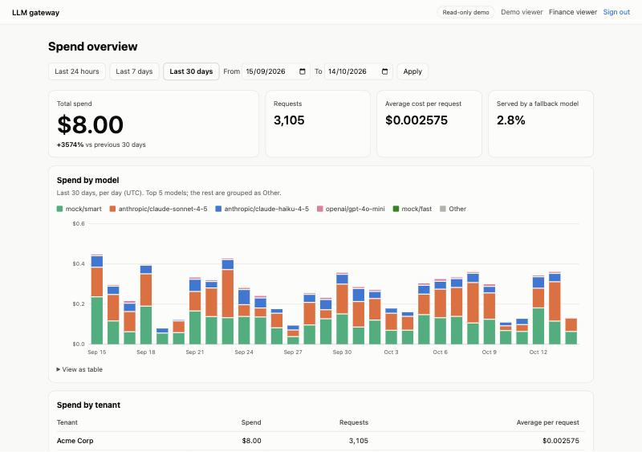
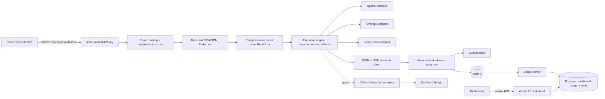

# LLM gateway

**One OpenAI-compatible API in front of OpenAI, Anthropic and local models, with automatic
fallback, hard per-tenant budgets, cost-aware routing and a spend dashboard.**

Point any OpenAI SDK at the gateway and change nothing else. The gateway picks the cheapest model
that can serve each request, retries and falls back when a provider fails, refuses requests that
would break a tenant's budget, and records the exact cost of every call.

[](https://github.com/Zaintol/llm-gateway/actions/workflows/ci.yml)

**Live demo:** not deployed yet (GW-10.3). Run it locally in about five minutes with the quickstart below.



## What it does

| Area                                                                          | What you get                                                                                                                                                                          | Status |
| ----------------------------------------------------------------------------- | ------------------------------------------------------------------------------------------------------------------------------------------------------------------------------------- | ------ |
| Unified API                                                                   | `POST /v1/chat/completions` and `GET /v1/models` in OpenAI shape, streaming included; adapters for OpenAI, Anthropic and OpenAI-compatible local models (Ollama, vLLM)                | ✅     |
| Reliability                                                                   | Request deadlines, per-attempt and first-token timeouts, retries with jittered backoff, `Retry-After` handling, ordered fallback chains, fallback only before the first streamed byte | ✅     |
| Cost control                                                                  | Atomic per-tenant daily and monthly hard budgets (402 before any provider call), RPM and TPM limits per key and tenant                                                                | ✅     |
| Routing                                                                       | `auto` and `gw/*` virtual models routed to the cheapest model meeting the request's capabilities, explained in `x-gateway-route-reason`                                               | ✅     |
| Metering                                                                      | Exact per-request cost in integer micro-USD at the price in effect when the request started; asynchronous, idempotent persistence                                                     | ✅     |
| Security                                                                      | Hashed API keys, envelope-encrypted provider credentials with key rotation, role-scoped admin API, audit log, redacted logs                                                           | ✅     |
| Observability                                                                 | OpenTelemetry trace per request (one span per provider attempt), tail sampling that keeps every error, JSON logs with trace ids                                                       | ✅     |
| Admin and dashboard                                                           | Admin API with OpenAPI 3.1; Next.js dashboard with spend by model and tenant, GitHub sign-in and a read-only demo                                                                     | ✅     |
| Gemini adapter, circuit breaker, hourly rollups, reliability view, load tests | Phase 2 in [PLAN.md](PLAN.md)                                                                                                                                                         | ⏳     |
| Public deployment                                                             | Fly.io, Neon, Upstash, Grafana Cloud (GW-10.3)                                                                                                                                        | ⏳     |

## Quickstart

Needs Docker. No provider keys: the bundled mock provider stands in for OpenAI and Anthropic.

```bash
git clone https://github.com/Zaintol/llm-gateway.git && cd llm-gateway
cp .env.example .env
docker compose up -d --build
```

Create demo tenants, an API key and 30 days of sample usage:

```bash
docker compose run --rm cli demo:seed
```

It prints an API key (`gw_live_…`) and a `DEMO_TENANT_ID`. Keep the key in your shell:

```bash
export GATEWAY_KEY=gw_live_...   # the key printed above
```

Call the gateway with any OpenAI SDK:

```python
import os
from openai import OpenAI

client = OpenAI(base_url="http://localhost:3000/v1", api_key=os.environ["GATEWAY_KEY"])
reply = client.chat.completions.create(
    model="auto",  # or a concrete model such as mock/fast
    messages=[{"role": "user", "content": "Hello, gateway"}],
)
print(reply.choices[0].message.content)
```

Or with curl, showing how the gateway routed the request:

```bash
curl -si localhost:3000/v1/chat/completions -H "authorization: Bearer $GATEWAY_KEY" -H "content-type: application/json" -d '{"model":"auto","messages":[{"role":"user","content":"Hello"}]}'
```

To open the dashboard, put the printed `DEMO_TENANT_ID` in `.env`, restart it, and choose
**Explore the read-only demo** at <http://localhost:3010>:

```bash
docker compose up -d dashboard
```

Other local services: Grafana with traces at <http://localhost:3001>, the mock provider at
<http://localhost:4000>. Local models: set `LOCAL_MODELS_BASE_URL=http://ollama:11434/v1` in
`.env` and run `docker compose --profile local-models up -d`.

## Architecture



| Package                  | Role                                                                                      |
| ------------------------ | ----------------------------------------------------------------------------------------- |
| `packages/gateway`       | Data plane (`/v1`), admin plane (`/admin/v1`), usage worker, CLI, migrations, catalog     |
| `packages/schema`        | Shared Zod schemas: the OpenAI-shaped wire format and error envelope                      |
| `packages/mock-provider` | OpenAI- and Anthropic-shaped fake upstream with failure modes, used by tests and the demo |
| `packages/dashboard`     | Next.js spend dashboard reading only through the admin API                                |

Design decisions and their trade-offs are recorded as ADRs in [docs/adr](docs/adr/README.md).

## Security model

- **API keys** are `gw_live_<prefix>_<secret>`; only the prefix and a SHA-256 hash are stored, and
  the full key is shown once. Revocation reaches every instance within a second (Redis pub/sub).
- **Provider credentials** are envelope-encrypted (AES-256-GCM data keys wrapped by a versioned
  master key); APIs only ever return the last four characters ([ADR 0005](docs/adr/0005-provider-credential-envelope-encryption.md)).
- **Admin access** uses 15-minute JWTs from the dashboard or hashed service tokens, with
  `platform_admin`, `tenant_admin` and `finance_viewer` roles scoped to a tenant; every change is audited.
- **No content at rest:** usage rows, logs and traces carry counts and identifiers, never prompts
  or completions. Logs redact credentials; prompt logging works only in development.
- **Demo isolation:** the public demo is meant to route only to the mock provider and free local
  models, with a small hard budget, so no real provider spend is possible from the internet.

## API reference

- Data plane: [docs/api/data-plane.openapi.json](docs/api/data-plane.openapi.json) (OpenAI-compatible)
- Admin plane: [docs/api/admin.openapi.json](docs/api/admin.openapi.json), also served at `/admin/v1/openapi.json`

Both are generated from the code (`pnpm docs:api`); CI fails if they are stale.

Useful response headers: `x-request-id`, `x-trace-id`, `x-gateway-provider`, `x-gateway-model`,
`x-gateway-attempts`, `x-gateway-route-reason`, `x-gateway-deadline-ms`, and the OpenAI-style
`x-ratelimit-*` headers.

## Performance

Load tests (k6: steady state, failover, budget contention) are planned in GW-10.2; numbers will be
published here with the hardware they ran on.

## Development

Requires Node 22+ and pnpm 10 (`corepack enable`).

```bash
pnpm install
pnpm lint && pnpm typecheck
pnpm test               # unit tests
pnpm test:integration   # Postgres and Redis via Testcontainers (needs Docker)
```

Run the gateway from source against the compose databases:

```bash
docker compose up -d postgres redis migrate
set -a && . ./.env && set +a && pnpm --filter @gw/gateway dev
```

Operator commands: `pnpm --filter @gw/gateway cli:dev <command>` (or `docker compose run --rm cli <command>`)
covers tenants, keys, credentials, budgets, rate limits, admin tokens and demo data; run it
without arguments for the list.

## Roadmap

See [PLAN.md](PLAN.md). Next: public deployment (GW-10.3), the contract test suite and coverage
gate (GW-10.1), then Phase 2: Gemini adapter, circuit breaker, capability inference, hourly
rollups, reliability dashboard and load tests.
